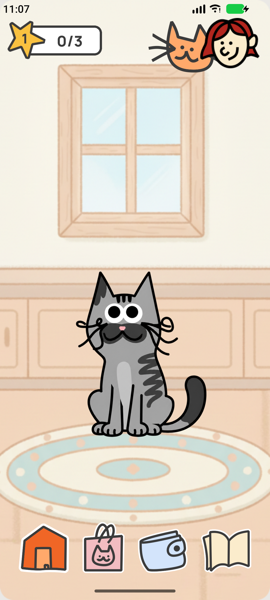

# Странник

**Финансовая грамотность через заботу о космическом коте.** Android-приложение для детей 7–11 лет: помогай питомцу вернуться домой, учись планировать покупки и распознавать мошенников.

Конкурсный прототип на Flutter: **3 стадии путешествия, 7 интерактивных заданий, локальное хранение и родительский раздел**. Реальные деньги и банковские реквизиты для игры не нужны.

## Ключевые экраны

Изображения работающего интерфейса, а не макеты Figma. Android-снимки взяты из сохранённых прогонов QA; Банк и мини-игра — рендеры Flutter widget-тестов. Балансы зависят от тестового сценария. [Происхождение изображений](screenshots/README.md).

<table>
  <tr>
    <td align="center"><br>Дом · Android</td>
  </tr>
</table>

## Что такое «Странник»

Дети получают карманные деньги, выбирают покупки и пробуют откладывать задолго до системного изучения финансов. «Странник» даёт пространство для таких решений через сюжет, понятные задачи и обратную связь.

Космический кот оказался на Земле со сломанным кораблём. Ребёнок знакомится с ним, выбирает имя и маскировку, помогает планировать расходы и готовиться к путешествию. Ошибки в заданиях сопровождаются объяснениями и возможностью повторить попытку.

## Основной игровой цикл

**Задание → награда → план бюджета → покупка или накопление → забота о питомце → XP и ресурсы → следующая стадия.**

Фиры — игровая валюта для покупок; XP — опыт. Переходы требуют подтверждённой цели, опыта и материалов. Земля, космос и родная планета имеют разные окружения. [Игровой процесс и условия переходов](docs/GAMEPLAY.md).

## Основные функции

| Раздел | Что есть в текущем коде |
|---|---|
| Первый запуск | Знакомство, имена ребёнка и питомца, три маскировки, согласие взрослого, локальный PIN |
| Дом | Питомец, прогресс заданий стадии, действия «Погладить», «Угостить», «Поиграть» |
| Банк | Один доступный кошелёк, план «Нужно / Хочу / Коплю», перераспределение, история, большая цель |
| Обучение | Задания трёх стадий, сохранение шагов, проверка ответов, объяснения, повторное прохождение |
| Магазин и шкаф | 7 товаров четырёх категорий, покупки, инвентарь, аксессуар, игрушка и расходуемые лакомства |
| Профили | Имя и аватар, настройки, PIN-защищённый родительский раздел, прогресс обучения, время в игре, подарки |
| Локальные данные | SQLite: профиль, баланс, инвентарь, задания, настройки и стадия; основной сценарий без сервера |

Это перечень реализации, а не заявление о завершённом релизном QA. Основания и ограничения: [отчёт ревизии](docs/DOCUMENTATION_AUDIT.md).

## Образовательные темы и механики

| Стадия | Доступные задания | Чему учимся |
|---|---|---|
| Земля | «Хочу или нужно?», «Планы на неделю», «Цель» | Различать желания и потребности, считать расходы, распределять бюджет и выбирать цель |
| Космос | «Список покупок», «Ловушки скидок» | Укладываться в ограниченную сумму и оценивать предложения продавцов |
| Родная планета | «Секретный звонок», «Поздравляем, ты выиграл!» | Распознавать давление и подозрительные письма, беречь секретные данные, обращаться к взрослому |

За первое завершение каждого задания начисляется **40 фир**. У заданий космоса и финансовой безопасности также есть **15 XP**. Повторное прохождение награду не дублирует. После двух расследований доступен финал темы «Финансовая безопасность» с отдельной однократной наградой **500 фир +30 XP**. Справка содержит все **8 правил** из утверждённого дизайна, открывается с карты и из уроков, сохраняет текущий шаг и не выдаёт награду. [Задания и награды](docs/LEARNING.md) · [Экономика и цены](docs/ECONOMY.md).

## Установка APK и запуск демоверсии

**Подписанный release APK готов.** Сборка от **20 октября 2026 года**:

| Параметр | Значение |
|---|---|
| Версия | 1.0.0, код сборки 1 |
| Android | 8.0 и новее |
| Размер | Около 79,2 МБ |
| Локальный файл | `build/app/outputs/flutter-apk/app-release.apk` |
| Проверки сборки | Release собран успешно; подпись проверена; debug-флаг отсутствует |

**[Скачать APK для Android](https://github.com/krawleek/strannik/releases/download/v1.0.0/app-release.apk)** · [Страница релиза](https://github.com/krawleek/strannik/releases/tag/v1.0.0) · [Контрольная сумма SHA-256](https://github.com/krawleek/strannik/releases/download/v1.0.0/SHA256SUMS.txt).

Это предварительный конкурсный релиз. [Сведения о сборке и подписи](docs/RELEASE_READINESS.md).

Чтобы установить предоставленный командой APK:

1. Перенесите `app-release.apk` на Android-устройство и откройте файл.
2. При запросе разрешите установку из приложения, через которое открыли APK.
3. Запустите «Странник», пройдите знакомство и задайте родительский PIN.

Установку и полное прохождение **именно этой release-сборки** ещё нужно проверить. Поверх debug-версии она не установится из-за другой подписи; используйте отдельное тестовое устройство, если нужно сохранить прежний прогресс.

После онбординга нажмите аватар ребёнка → «Демо-режим» → введите созданный взрослым PIN. Демо облегчает доступ к заданиям **текущей стадии**, но не выдаёт деньги и не переводит питомца на следующую стадию. [Пошаговый маршрут для жюри](docs/DEMO_GUIDE.md).

### Запуск из исходников

Для запуска нужны Flutter и Android toolchain. Проверенная локальная среда — Flutter **3.47.5**, Dart **3.13.4**. Требования к JVM и структура проекта: [архитектура](docs/ARCHITECTURE.md).

```bash
flutter doctor
flutter pub get
flutter devices
flutter run -d <device-id>
```

Debug APK для локальной демонстрации:

```bash
flutter build apk --debug
```

Результат: `build/app/outputs/flutter-apk/app-debug.apk`.

Для повторной сборки release используйте `flutter build apk --release` после локальной настройки ключа подписи. [Настройка подписи](docs/RELEASE_READINESS.md#как-передать-уже-существующие-ключи).

## Технологии и архитектура

Flutter / Dart, `sqflite`, `cryptography`, локальные иллюстрации и Manrope. Слои `presentation → app/domain → repositories → SQLite`; покупки, награды и переходы используют транзакции. Backend и обязательная регистрация отсутствуют.

[Структура проекта и хранение](docs/ARCHITECTURE.md) · [Подробности онбординга](ONBOARDING.md) · [Дизайн в Figma](https://www.figma.com/design/sZM7SZ1aoBWiBmDS6LqAoC/Pet-Finance-App).

## Текущий статус реализации

**Реализовано в коде и покрыто тестами:** основные разделы, семь заданий, покупки и инвентарь, план бюджета, цели, два перехода стадий, PIN и локальное хранение. Утверждённая тема Stage 3 из двух расследований имеет справку, финал, карту с прогрессом 0/2–2/2 и сохранение однократных наград между запусками.

**Частично реализовано:** демонстрационный доступ без UI выбора стадии; звуковые эффекты и вибрация без полноценной музыки; родительская статистика, учитывающая старые пустые темы; отдельная legacy-модель накоплений наряду с актуальной большой целью.

Полное прохождение Android от первого запуска до финала третьей стадии **подтверждено**, включая обычные переходы стадий и отдельный запуск нового процесса приложения. [Подробный отчёт Stage 3](STAGE3_IMPLEMENTATION.md) · [Общая ревизия и подготовка к сдаче](docs/DOCUMENTATION_AUDIT.md). Результаты более поздней проверки Stage 3 уточняют прежние ограничения общей ревизии.

## Проверки и тестирование

```bash
dart format .
flutter analyze
flutter test
flutter build apk --debug
```

Последняя проверка Stage 3 от **20.10.2026**: `dart format .` выполнен, `flutter analyze` — без замечаний, `flutter test` — **160 успешных, 0 проваленных**, обычный `flutter build apk --debug` — успешно. Это зафиксированный результат проверки, а не гарантия для последующих изменений рабочего дерева.

**20.10.2026:** `flutter build apk --release` — успешно; подпись готового APK проверена через `apksigner verify`. Новый прогон тестов и проверка установки release APK в этом этапе не выполнялись.

Полный Android E2E прошёл за **8 минут 34 секунды**: онбординг → все задания Stage 1 → цель и Банк → покупки → Stage 2 и оба задания → Stage 3 и оба расследования → справка → финал → Дом. Стадии, завершения и баланс не подставлялись. Отдельная проверка нового процесса восстановила Stage 3, карту 2/2, **783 фир и 102 XP**; повторное открытие финала не изменило баланс, XP и число транзакций. Это значения конкретного QA-сценария. Команды повторения и пути к снимкам приведены в [отчёте Stage 3](STAGE3_IMPLEMENTATION.md#10-tests-build-and-screenshots).

Тесты проверяют однократные награды, конкурентные покупки, откат записей, обучение, переходы, PIN, сохранение и адаптацию отдельных экранов. Существуют Android integration-тесты. [Результаты и ограничения](docs/DOCUMENTATION_AUDIT.md#проверки) · [Предложение GitHub Actions CI](docs/CI_PROPOSAL.md).

## Команда и авторство

Проект создан командой выпускников **Школы дизайна НИУ ВШЭ**, объединивших компетенции в продуктовом дизайне, иллюстрации, брендинге и разработке прототипов.

**Автор оригинальных иллюстраций — Наталия Скороходова.** При работе над частью визуальных материалов применялись генеративные инструменты **ChatGPT/OpenAI**; материалы дорабатывались в рамках общей визуальной системы. Runtime-генерации изображений нет: assets поставляются локально.

Шрифт **Manrope**, локальные начертания 600/700/800; лицензия находится в `assets/fonts/Manrope-OFL.txt`. Происхождение визуальных материалов: [assets](assets/README.md), [финансовая безопасность](assets/learning/SAFETY_ASSETS.md), [скидки](assets/learning/DISCOUNT_ASSETS.md).
